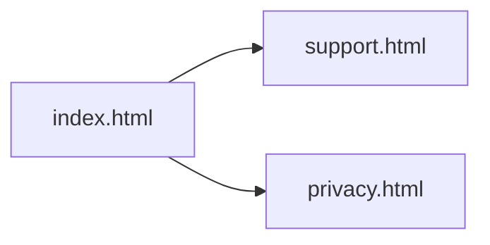

# Spendster Site

Static pages for Spendster: a short landing page, a privacy policy, and a support page.

## Project Overview

`spendster-site` is three HTML files with inline CSS. There is no build step and no application code. The landing page describes Spendster as an expense tracker and links to support and the privacy policy.

The support page covers adding, editing, and deleting an expense. The privacy policy, last updated August 2026, says the app collects name, email, and expense records, and uses them to authenticate the account and sync expenses.

The Spendster app itself is a separate repository. This repo is only the public site.

## Features

- Landing page (`index.html`) with links to support and privacy
- Support page (`support.html`) with contact and three FAQs
- Privacy policy (`privacy.html`)
- Shared layout: centered column, system font, light background

## Tech Stack

- HTML
- CSS in each file
- No JavaScript, package manager, or backend

## Architecture

Each page is self-contained. Navigation is a normal link between files.



## Local Setup

No install and no environment variables.

```bash
open index.html
```

Or serve the directory:

```bash
python3 -m http.server 8000
```

Then open `http://localhost:8000`.

## Database Design

No database. Expense records are not stored in this repo.

## API Overview

No API. The contact link is a `mailto:` on the support and privacy pages.

## Security

These files are public marketing and policy pages. Do not put secrets or customer data in them. The privacy page states that Spendster does not sell personal information.

## Design Decisions

- One file per page, with CSS inlined, so the site can be hosted without a bundler.
- The FAQ matches the app's expense actions: add from the "+" button, edit from the expense, delete from the expense.
- Policy copy lives in HTML rather than a CMS.

## Optimizations

The pages are small and have no images, web fonts, or scripts. Inline CSS avoids an extra request.

## Deployment

Upload the three HTML files to any static host. Keep the filenames so the links from `index.html` keep working.

No environment variables and no build command.

## Lessons Learned

- This site and the Spendster app can drift. If adding or editing an expense changes in the app, update `support.html` in the same change.
- If the app starts collecting more than name, email, and expense records, update `privacy.html` and the "Last updated" line.

## License

MIT. Copyright (c) 2026 Rishabh Sharma. See [LICENSE](LICENSE).
